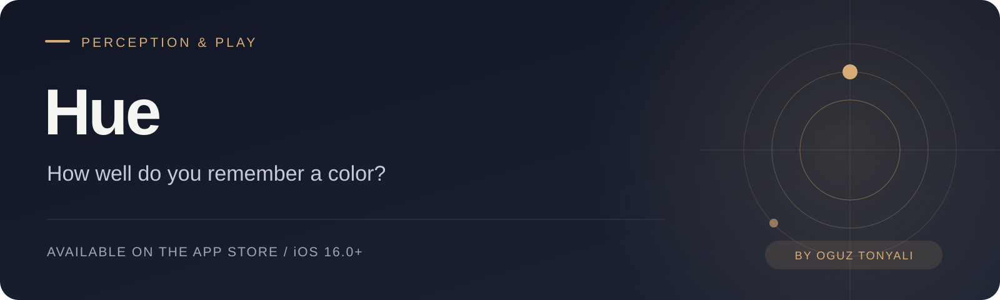
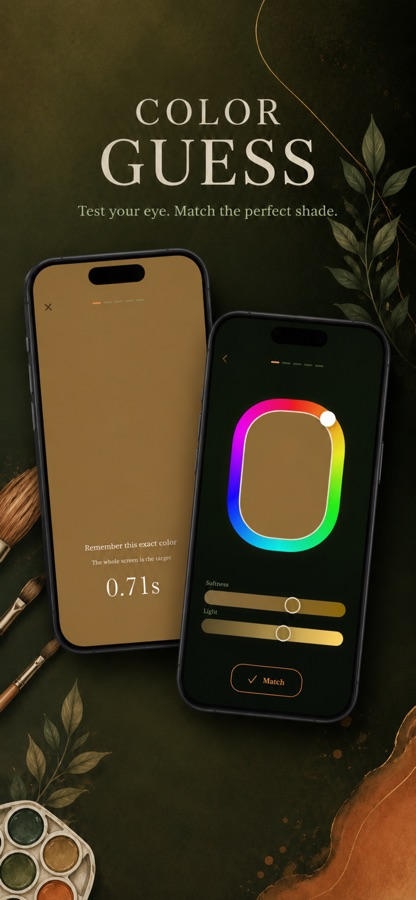
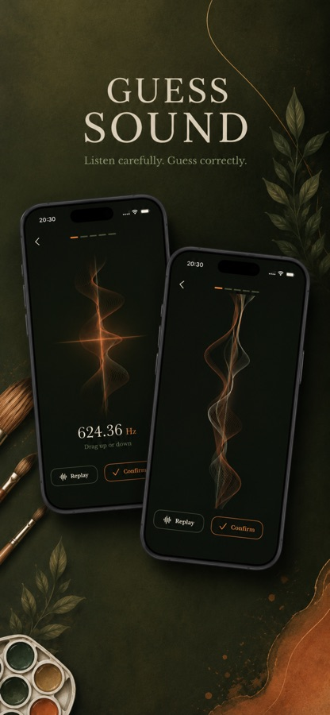
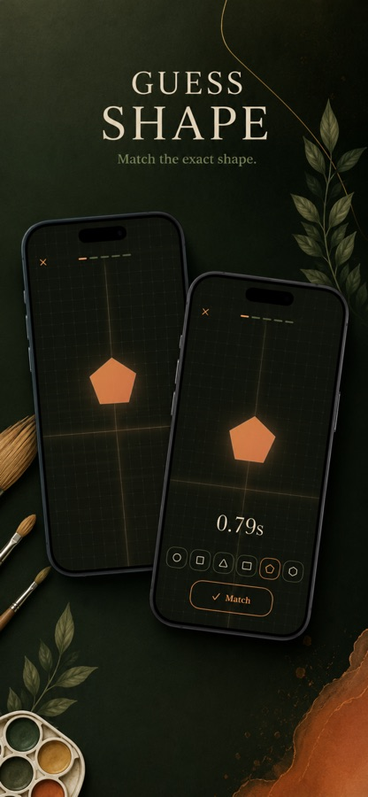

  <a href="https://apps.apple.com/us/app/hue-dialed-color-match-game/id6770094040"><strong>View on the App Store ↗</strong></a> &nbsp; · &nbsp;
  <a href="docs/ENGINEERING.md">Engineering notes</a> &nbsp; · &nbsp;
  <a href="https://github.com/Zodomik">More by Oğuz Tonyalı</a>

## Hue

A collection of sensory mini-games around color, sound, timing and shape. Brief challenges, tactile controls and a warm visual style turn perception into a playful daily habit.

Built and published by **[Oğuz Tonyalı](https://github.com/Zodomik)**. This repository is a public product and engineering showcase; the application source is maintained privately.

## A look inside

  
  
  

*Official product previews from the [App Store listing](https://apps.apple.com/us/app/hue-dialed-color-match-game/id6770094040).*

## What you can do

- Recreate a color after the reference disappears.
- Match pitch, repeat a duration and recall geometric shapes.
- Daily challenges, streaks and statistics.
- Online play and a choice of visual themes.

## Technology

| Area | Technologies | Role in the product |
| --- | --- | --- |
| iOS | Swift, SwiftUI, Combine | Game screens, reactive state and tactile controls. |
| Color scoring | CIE LAB, CIEDE2000 | Perceptual color difference rather than raw RGB distance. |
| Sound | AVFoundation, AVAudioEngine | Procedural tone generation and audio playback. |
| Online client | URLSession WebSockets | Room and match messages for online play. |
| Backend | TypeScript, Node.js, Express, Socket.IO, Prisma, PostgreSQL | Online room flow, scoring and persistent match data. |

## Implementation notes

SwiftUI client; Express/Socket.IO service; Prisma/PostgreSQL match history; process-local rooms and matchmaking.

- CIEDE2000 color distance, logarithmic pitch error and symmetry-aware shape scoring.
- Runtime sine-wave synthesis with smoothed frequency/amplitude changes.
- Date-seeded daily targets and per-mode score records.

| Read more | What is covered |
| --- | --- |
| [Architecture and frameworks](docs/ENGINEERING.md) | Runtime components, backend structure and framework responsibilities |
| [Database and local data](docs/DATA_MODEL.md) | Entities, relationships, constraints and persistence choices |
| [Algorithms and implementation choices](docs/ALGORITHMS.md) | Calculations, example flows and the limits of each approach |

## Try the product

**[Open Hue on the App Store](https://apps.apple.com/us/app/hue-dialed-color-match-game/id6770094040)** · Requires iOS 16.0 or later.

Availability and purchase options are shown in the store. For product support, use the developer links on the App Store listing.

---

[All published apps](https://apps.apple.com/us/developer/oguz-tonyali/id1880078720) · [Developer profile](https://github.com/Zodomik) · [Media credits](assets/SOURCES.md)
