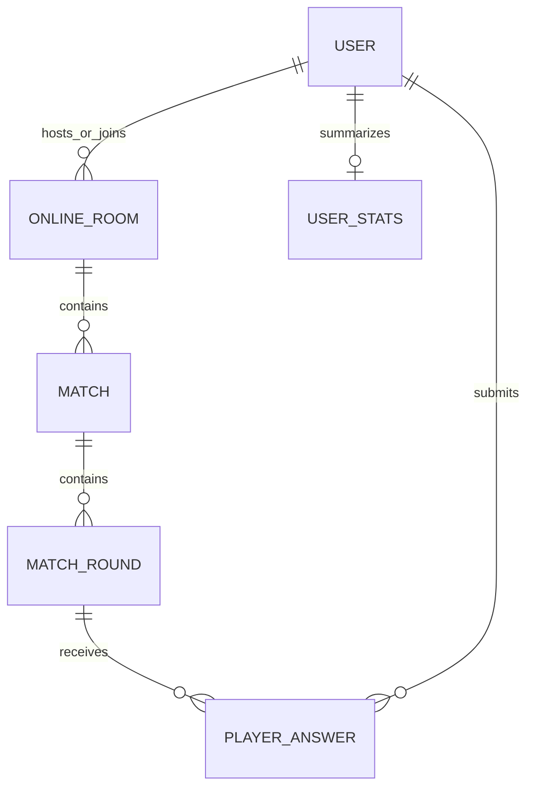

# Hue · Data model

**Server:** PostgreSQL through Prisma. **Device:** Codable round history and preferences in UserDefaults. **Live coordination:** in-memory maps, sets, a queue and timers.

| Entity | Stored information |
| --- | --- |
| User | Device-based identity, display name, optional unique player tag and activity timestamps |
| OnlineRoom | Unique join code, mode, lifecycle state, host and optional guest |
| Match | Room, participants, winner, score totals, round count and timestamps |
| MatchRound | Match, round index, JSON target/options and start/end time |
| PlayerAnswer | Round, user, JSON answer details, accuracy, response time and score |
| UserStats | One summary per user: matches, wins/losses, best score and average accuracy |
| DailyChallenge | One row per date with generated rounds in JSON |
| DailyScore | Date, device, mode, display identity and best submitted score |

The diagram simplifies the separate host, guest and winner relationships in the schema. Daily challenges/scores are keyed by their date and are queried separately from the match graph.

## Constraints and lookup structure

- Device identity, player tag and room join code are unique where declared.
- `(matchRoundId, userId)` uniquely identifies a player’s answer.
- `UserStats.userId` is unique, so each player has one aggregate row.
- `DailyChallenge.date` is unique.
- `(date, deviceId, mode)` identifies a daily score. `(date, mode, score)` is indexed for ranking.

JSON target and answer payloads let color, pitch, duration and geometry share the match schema. Their numeric and shape fields differ, but their room/round/participant relationships do not.

## Live state versus durable records

The room store keeps maps for room ID and code, readiness sets and per-round answers. The matchmaking queue pairs waiting players in the same mode. Timer handles schedule round completion and cleanup. Those objects are process-local; their presence should not be confused with a durable or distributed queue.

On-device `UserDefaultsStore` holds round results and preferences such as theme, haptics, memory time, scoring forgiveness and challenge intensity. Local statistics are computed from those saved results.

[Architecture](ENGINEERING.md) · [Algorithms](ALGORITHMS.md)
