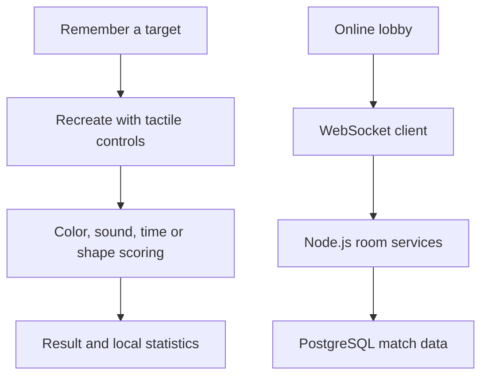

# Hue · Engineering notes

This overview describes the product’s implementation at a component level. It accompanies the [product showcase](../README.md).

## Component map

The diagram emphasizes responsibilities and data flow. Platform integrations can have their own independent lifecycle.

## Design decisions

### Color science in a game loop

The scoring utility converts sRGB values through XYZ into LAB, then calculates CIEDE2000 color difference. A perceptual distance maps a player’s guess to a score.

### Generated sound rather than a fixed clip library

AVAudioEngine and a source node generate tones for pitch-matching gameplay. This allows the target and the player’s adjustment to share the same audio-generation model.

### Separate game and connection state

Game view models manage round progression while socket and online services handle connection and room events. Daily challenges and match history are represented separately from an active round.

## Stack reference

| Area | Technologies | Responsibility |
| --- | --- | --- |
| iOS | Swift, SwiftUI, Combine | Game screens, reactive state and tactile controls. |
| Color scoring | CIE LAB, CIEDE2000 | Perceptual color difference rather than raw RGB distance. |
| Sound | AVFoundation, AVAudioEngine | Procedural tone generation and audio playback. |
| Online client | URLSession WebSockets | Room and match messages for online play. |
| Backend | TypeScript, Node.js, Express, Socket.IO, Prisma, PostgreSQL | Online room flow, scoring and persistent match data. |

## Scope

The technology summary was checked against the application’s Swift imports, project configuration and relevant service/model implementations. Backend technologies, where listed, were checked against the associated package manifest and database schema. Store screenshots illustrate the released product; the private working project may continue evolving after release.

This documentation publishes no credentials, deployment configuration, private endpoints or application source. Product behavior and supported devices are described in the [current App Store listing](https://apps.apple.com/us/app/hue-dialed-color-match-game/id6770094040).
