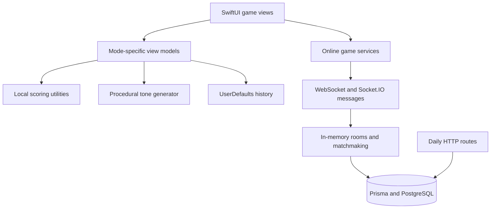

# Hue · Architecture

*Implementation notes checked against the working project on 20 November 2026. Store builds may differ as the project evolves.*

Hue has a native sensory-game client and an online service for rooms, matches and daily scores.

| Layer | Technology | Responsibility |
| --- | --- | --- |
| iOS | Swift, SwiftUI, Combine | Round state, tactile controls, results and settings |
| Audio | AVFoundation, AVAudioEngine, AVAudioSourceNode | Procedural tones and playback |
| Game calculations | Foundation and app utilities | Color difference, pitch, timing and shape accuracy |
| Local persistence | Codable JSON, UserDefaults | Round history, preferences and local statistics |
| Transport | URLSessionWebSocketTask | Native client messaging for online play |
| Backend | TypeScript, Node.js, Express, Socket.IO, Zod | HTTP routes, socket events, payload validation and room lifecycle |
| Database | Prisma, PostgreSQL | Users, rooms, matches, rounds, answers and daily scores |
| Optional integration | ioredis | Optional Redis connection hook; active room/queue state remains in process |
| Monetization | Google Mobile Ads | Rewarded/interstitial ad integration |

## Round and room state

Local play separates color, sound, time and shape scoring from screen presentation. The online layer adds lobby, connection, match history and daily challenge services.

The server has a room store indexed by room ID and join code, plus a mode-specific matchmaking queue. Room states cover waiting, ready, in-game, finished and cancelled. Active rooms keep readiness sets, answer maps and timers in memory. Match and answer data is also recorded through Prisma for later history/statistics.

This separation is important: PostgreSQL is durable history, while the current process owns live room coordination. The optional Redis connection in the entrypoint does not by itself provide shared rooms, a Socket.IO Redis adapter or distributed matchmaking.

## Online messages and persistence

The service handles user initialization, room creation/join/readiness, matchmaking, answer submission, continuing a round, rematches and disconnects. Zod parses payload shape and numeric ranges. An answer map admits one answer per participant for the current round; a database uniqueness rule also identifies an answer by round and user.

For the general multi-mode handler, the client calculates accuracy and the server validates the submitted range, converts it into a score and records it. Describing this implementation as fully server-recomputed scoring would overstate what the active handler does.

## Daily challenges

Express routes get or create a daily challenge, accept daily scores and produce leaderboards. The date seeds a repeatable set of target values. Scores are stored per date, device and mode; an improved submission replaces the earlier score, while a lower one keeps the existing best.

The schema uses an index on date, mode and score for leaderboard queries. Local preferences and offline round statistics remain independent of that online score table.

## Code landmarks

`GameViewModel`, `ColorScience`, `SoundScoringUtility`, `ShapeScoring`, `ToneGenerator`, `SocketManager`, `RoomStore`, `MatchmakingQueue`, socket handlers and daily routes.

**Continue:** [Data model](DATA_MODEL.md) · [Algorithms](ALGORITHMS.md) · [Product](../README.md)
